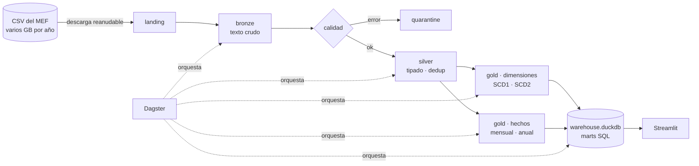

# Lakehouse del gasto público del Perú

[](https://github.com/Key-qr/lakehouse-gasto-publico-peru/actions/workflows/ci.yml)


Plataforma de datos de punta a punta sobre la **ejecución presupuestal del Estado peruano**, construida con la arquitectura medallion (bronze, silver, gold) sobre tablas Delta Lake.

Toma los CSV oficiales que publica el MEF (un archivo por año, varios GB cada uno, de 2012 a hoy), los ingiere con control de duplicados, valida la calidad fila por fila, separa lo que no cumple en cuarentena, modela el resultado como un esquema estrella con historia de entidades (SCD tipo 2) y lo publica en un warehouse DuckDB con marts en SQL y un dashboard.

Responde preguntas como: ¿qué departamentos ejecutan menos de su presupuesto?, ¿cómo avanza el gasto mes a mes?, ¿qué proyectos de inversión están por debajo del 40 % de avance?

> Fuente: [Presupuesto y Ejecución de Gasto](https://www.datosabiertos.gob.pe/dataset/presupuesto-y-ejecuci%C3%B3n-de-gasto) · Ministerio de Economía y Finanzas · Plataforma Nacional de Datos Abiertos.

---

## Arquitectura



| Capa | Qué guarda | Cómo se carga |
|---|---|---|
| **bronze** | el CSV tal cual, todo como texto, con batch, archivo, fecha y número de fila | append; un archivo con el mismo SHA-256 no se vuelve a ingerir |
| **silver** | tipado (montos en `Decimal(20,2)`), nombres normalizados, sin duplicados, al grano declarado | reemplazo atómico de la partición del año |
| **quarantine** | filas rechazadas con el motivo y su número de fila en el CSV | reemplazo por año |
| **gold** | esquema estrella: 2 hechos y 7 dimensiones, `dim_entidad` con historia SCD2 | dimensiones por MERGE / reconstrucción, hechos por año |
| **_meta** | manifiesto de ingesta, resultados de calidad, registro de corridas | append / MERGE |

Detalle completo en [docs/arquitectura.md](docs/arquitectura.md) y el modelo en [docs/modelo_de_datos.md](docs/modelo_de_datos.md).

## Stack

| | |
|---|---|
| Almacenamiento | Delta Lake (delta-rs): ACID, time travel, `replaceWhere`, MERGE, OPTIMIZE / Z-ORDER, VACUUM |
| Procesamiento | Polars (lazy + motor streaming), PyArrow para lectura de CSV por bloques |
| Warehouse y marts | DuckDB + SQL (window functions, `GROUP BY ALL`) |
| Orquestación | Dagster: software-defined assets, asset checks, schedule mensual, sensor de archivos nuevos |
| Calidad | reglas como expresiones Polars, cuarentena, circuit breaker, reconciliación al céntimo |
| Visualización | Streamlit + Plotly |
| Ingeniería | pytest (35 tests), ruff, GitHub Actions (lint, matriz 3.11-3.13, e2e), Docker Compose |

Por qué Polars y no Spark para este volumen: [ADR 0002](docs/adr/0002-motor-y-almacenamiento.md). Las tablas son Delta estándar, así que Spark o Databricks las leen sin conversión.

## Inicio rápido

Requisitos: Python 3.11 o superior. No hace falta Java, Docker ni ninguna cuenta.

```bash
git clone https://github.com/Key-qr/lakehouse-gasto-publico-peru.git
cd lakehouse-gasto-publico-peru

python -m venv .venv
source .venv/bin/activate          # Windows (Git Bash): source .venv/Scripts/activate
pip install -e ".[dev,dashboard,orchestration]"

lakehouse sample -y 2023 -y 2024 -y 2025 --months 9   # datos sintéticos con el contrato del MEF
lakehouse run                                          # landing -> bronze -> silver -> gold -> warehouse
streamlit run dashboard/app.py                         # http://localhost:8501
```

Con `make` disponible: `make install && make demo && make dashboard`.

Con Docker: `docker compose up --build` levanta el pipeline, Dagster en `:3000` y el dashboard en `:8501`.

### Con datos reales del MEF

```bash
lakehouse download -y 2024     # ~GB; se puede cortar y reanudar
lakehouse run
lakehouse quality              # resultado de cada regla
lakehouse status               # versión y filas de cada tabla
```

Las URL oficiales están en [config/sources.yaml](config/sources.yaml).

## Lo que muestra el proyecto

**Ingesta robusta.** Descarga reanudable con HTTP Range. Detección de separador y encoding (el MEF ha publicado en UTF-8 y Latin-1). Lectura del CSV en bloques de 16 MB y escritura en streaming: un año de varios GB entra con memoria acotada. Un manifiesto por SHA-256 hace que reingerir el mismo archivo no tenga efecto.

**Calidad de datos como parte del pipeline.**

```
$ lakehouse quality
ano_eje  regla                          severidad  filas_fallidas  tasa_cumplimiento
2024     ano_coincide_con_archivo       error      0               1.0
2024     llaves_no_nulas                error      0               1.0
2024     mes_en_rango                   error      29              0.999518
2024     montos_numericos               error      29              0.999518
2024     nivel_gobierno_valido          error      29              0.999518
2024     devengado_no_negativo          warn       59              0.999019
2024     girado_no_supera_comprometido  warn       0               1.0
```

Las filas en error van a cuarentena con su motivo y el número de fila del CSV original. Si superan el 5 % del año, el año entero se rechaza y silver queda intacto ([ADR 0007](docs/adr/0007-calidad-de-datos.md)).

**Carga incremental idempotente.** El MEF republica el año completo cada mes, así que silver reemplaza la partición del año en una sola transacción. Qué procesar se decide comparando el estado de las tablas, no con parámetros: una corrida que falló a la mitad se retoma sola y una segunda corrida sin cambios termina en `noop` ([ADR 0003](docs/adr/0003-carga-incremental.md)).

**Modelado dimensional con historia.** `dim_entidad` guarda cada cambio de nombre, sector o ubicación de una unidad ejecutora como una versión SCD2, reconstruida por *gaps and islands*. Los hechos resuelven la versión vigente en cada periodo con un as-of join. Si se recarga un año pasado y la historia cambia, el pipeline detecta los hechos de otros años que quedaron apuntando a versiones viejas y los recalcula ([ADR 0005](docs/adr/0005-scd2-entidad.md)).

```
sec_ejec  version  valido_desde  valido_hasta  es_vigente  ejecutora_nombre
300000    1        202301        202307        false       AGRARIO Y DE RIEGO - UNIDAD EJECUTORA 000
300000    2        202307        999912        true        AGRARIO Y DE RIEGO - UNIDAD EJECUTORA 000 (REORGANIZADA)
```

**Semántica de negocio explícita.** PIA y PIM son presupuesto (stock), no flujo: sumarlos mes a mes inflaría el presupuesto 12 veces. El pipeline perfila cada año, decide cómo agregarlos y deja el modo usado en el hecho ([ADR 0006](docs/adr/0006-semantica-presupuesto.md)).

**Exactitud verificable.** En cada corrida el devengado de silver, de `fact_ejecucion_mensual` y de `fact_presupuesto_anual` tiene que cuadrar al céntimo, y ningún hecho puede quedar sin dimensión. Si no cuadra, la corrida falla.

**Trazabilidad.** Cada hecho lleva el `_batch_id` del que salió; el manifiesto lo une con el archivo y su hash. Cada corrida queda en `_meta/pipeline_runs` con estado, duración y error. Delta guarda el historial: `lakehouse history silver.gasto`.

## Rendimiento

Un año de **2 millones de filas (CSV de 1,4 GB)** de punta a punta en **53 s** con 2 vCPU y 3,3 GB de memoria pico. El CSV queda en 104 MB en bronze. Perfilar silver y normalizar una sola vez bajó esa etapa de 165 s a 33 s. Detalle en [docs/benchmark.md](docs/benchmark.md).

## Orquestación

```bash
dagster dev -m gasto_lakehouse.orchestration      # http://localhost:3000
```

Cinco assets (`bronze_gasto` → `silver_gasto` → `gold_dimensiones` → `gold_hechos` → `warehouse_duckdb`) con metadatos por materialización, dos asset checks (calidad de silver y reconciliación de gold), un schedule el día 5 de cada mes a las 6:00 hora de Lima y un sensor que dispara el pipeline cuando aparece un archivo nuevo en landing. CLI y Dagster ejecutan el mismo código.

## Pruebas y CI

```bash
pytest --cov=gasto_lakehouse
```

Los tests cubren cada regla de calidad con su defecto, la deduplicación, el rechazo de un lote malo sin tocar silver, el reemplazo de partición, la historia SCD2 sin huecos ni solapes, la resolución as-of de versiones, la reconciliación, la detección de semántica del presupuesto, la idempotencia, la recarga de años pasados, la descarga reanudable contra un servidor HTTP local y la materialización completa en Dagster.

GitHub Actions corre lint, la suite en Python 3.11, 3.12 y 3.13, y un e2e que genera 600 mil filas, corre el pipeline dos veces (la segunda debe ser `noop`), valida Dagster y hace un smoke test del dashboard.

## Estructura

```
├── config/sources.yaml          URL oficiales por año
├── src/gasto_lakehouse/
│   ├── schema.py                contrato de las 63 columnas del MEF
│   ├── ingestion/               descarga reanudable y generador de muestra
│   ├── bronze.py                CSV -> Delta en streaming + manifiesto
│   ├── quality.py               reglas, cuarentena, circuit breaker
│   ├── silver.py                normalización, dedup, grano
│   ├── gold.py                  dimensiones SCD1/SCD2, hechos, reconciliación
│   ├── sql/                     marts en SQL (DuckDB)
│   ├── export.py                warehouse.duckdb
│   ├── pipeline.py              etapas y registro de corridas
│   ├── orchestration.py         Dagster
│   ├── storage.py               acceso a Delta
│   └── cli.py                   comando `lakehouse`
├── dashboard/                   Streamlit
├── tests/
├── scripts/benchmark.py
└── docs/                        arquitectura, modelo, benchmark y ADRs
```

## Decisiones de arquitectura

| ADR | Decisión |
|---|---|
| [0001](docs/adr/0001-arquitectura-medallion.md) | Medallion sobre Delta Lake |
| [0002](docs/adr/0002-motor-y-almacenamiento.md) | Polars + delta-rs + DuckDB en un nodo, no Spark |
| [0003](docs/adr/0003-carga-incremental.md) | Reemplazo de partición por año en vez de MERGE |
| [0004](docs/adr/0004-llaves-sustitutas.md) | Llaves sustitutas por hash determinista |
| [0005](docs/adr/0005-scd2-entidad.md) | SCD2 de entidades reconstruida desde silver |
| [0006](docs/adr/0006-semantica-presupuesto.md) | PIA/PIM como stock con detección automática |
| [0007](docs/adr/0007-calidad-de-datos.md) | Motor de calidad propio con cuarentena |

## Próximos pasos

- Validar los totales de PIM y devengado contra los reportes publicados en Consulta Amigable para cada año cargado.
- Publicar el dashboard con datos reales en Streamlit Community Cloud (`make demo-data` exporta los marts, unos pocos MB).
- Cargar la serie completa 2012-2026 y agregar marts de tendencia interanual.

## Licencia

Código bajo licencia MIT. Los datos son del Ministerio de Economía y Finanzas, publicados como datos abiertos.
