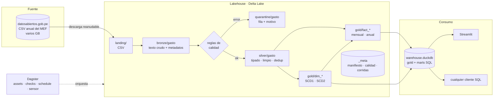

# Arquitectura



## Recorrido de un archivo

1. **Descarga** (`lakehouse download -y 2024`). HTTP con `Range` para reanudar; escribe a `.part` y renombra al final. No vuelve a bajar si el tamaño local coincide con el del servidor.
2. **Bronze**. Se calcula el SHA-256; si ya está en el manifiesto, se omite. Se detecta separador y encoding, se lee el CSV en bloques de 16 MB con PyArrow forzando todo a texto y se escribe a Delta en streaming, particionado por año de origen, con `_batch_id`, `_source_file`, `_ingested_at` y `_row_number` en cada fila.
3. **Silver**. Normalización y reglas de calidad en una sola pasada streaming hacia un Parquet de trabajo temporal (normalizar es la parte cara y así se hace una vez). Con ese archivo se calculan las métricas; si las filas en error superan el umbral, se corta aquí y nada se publica. Las filas en error van a cuarentena. Luego, mes por mes, deduplicación exacta y consolidación al grano; todos los meses se escriben en una sola transacción que reemplaza la partición del año.
4. **Gold**. Se reconstruyen las dimensiones (SCD1 por MERGE, SCD2 por gaps and islands) y se recalculan los hechos de los años pendientes. Cada año se reconcilia contra silver al céntimo.
5. **Warehouse**. Gold se carga en un DuckDB temporal, se aplican los SQL de `sql/` y el archivo reemplaza al anterior de forma atómica.

## Garantías

| Garantía | Cómo se logra |
|---|---|
| Idempotencia | manifiesto por SHA-256 + procesamiento decidido por estado (ADR 0003) |
| Atomicidad por año | una transacción Delta por partición; el warehouse se reemplaza con `os.replace` |
| Memoria acotada | lectura por bloques, motor streaming de Polars, procesamiento mes a mes |
| Trazabilidad | `_batch_id` de bronze a gold, `_row_number` en cuarentena, `_meta/pipeline_runs` |
| Exactitud | reconciliación silver ↔ hechos y control de huérfanos en cada corrida |
| Historia | time travel de Delta (`lakehouse history silver.gasto`) y SCD2 en entidades |

## Layout en disco

```
data/
├── landing/                       CSV tal como se descargan
├── lakehouse/
│   ├── bronze/gasto/              _source_year=AAAA/
│   ├── silver/gasto/              ano_eje=AAAA/
│   ├── quarantine/gasto/          _source_year=AAAA/
│   ├── gold/
│   │   ├── dim_*/
│   │   ├── fact_ejecucion_mensual/   ano_eje=AAAA/
│   │   └── fact_presupuesto_anual/   ano_eje=AAAA/
│   └── _meta/{ingestion_manifest, quality_results, pipeline_runs}/
└── warehouse.duckdb
```

## Mantenimiento

`lakehouse optimize` compacta archivos chicos de todas las tablas y aplica Z-ORDER a los hechos por `periodo_sk` y `entidad_sk`, que son los filtros más comunes. Con `--vacuum-hours 168` además elimina archivos que ya no referencia ninguna versión de la última semana.

## Paleta del dashboard

Una sola serie por gráfico, en azul `#2a78d6`, sobre superficie `#fcfcfb`. El semáforo de proyectos usa colores de estado reservados y siempre va acompañado de forma (● ▲ ■) y texto, para que no dependa solo del color.
