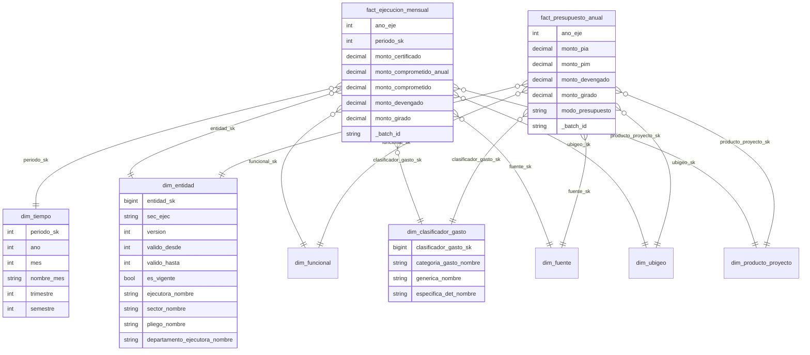

# Modelo de datos

## Silver · `silver/gasto`

Una fila por **periodo (año, mes) y combinación completa de códigos** del archivo del MEF. Particionada por `ano_eje`.

| Grupo | Columnas | Tipo |
|---|---|---|
| Periodo | `ano_eje`, `mes_eje` | Int16, Int8 |
| Códigos (29) | `nivel_gobierno`, `sector`, `pliego`, `sec_ejec`, `ejecutora`, ubicación de la ejecutora, `sec_func`, `programa_ppto`, `tipo_act_proy`, `producto_proyecto`, `actividad_accion_obra`, `funcion`, `division_funcional`, `grupo_funcional`, `meta`, `finalidad`, `departamento_meta`, `fuente_financiamiento`, `rubro`, `tipo_recurso`, `categoria_gasto`, `tipo_transaccion`, `generica` … `especifica_det` | texto sin espacios sobrantes |
| Nombres (25) | `*_nombre` | texto en mayúsculas, espacios colapsados |
| Montos (7) | `monto_pia`, `monto_pim`, `monto_certificado`, `monto_comprometido_anual`, `monto_comprometido`, `monto_devengado`, `monto_girado` | Decimal(20,2) |
| Linaje | `_batch_id`, `_run_id`, `_updated_at` | |

El contrato completo (63 columnas, en el orden del diccionario oficial `Gastos_Diccionario.csv`) está en `src/gasto_lakehouse/schema.py`.

## Gold · modelo estrella

### Hechos

| Tabla | Grano | Medidas | Partición |
|---|---|---|---|
| `fact_ejecucion_mensual` | periodo × entidad (versión) × funcional × clasificador × fuente × ubigeo × producto/proyecto | certificado, comprometido anual, comprometido, devengado, girado (flujo del mes) | `ano_eje` |
| `fact_presupuesto_anual` | año × mismas dimensiones | PIA, PIM (stock, ver ADR 0006) + ejecución acumulada del año | `ano_eje` |

### Dimensiones

| Tabla | Llave natural | Tipo |
|---|---|---|
| `dim_tiempo` | `periodo_sk` (AAAAMM; mes 0 = apertura) | estática |
| `dim_entidad` | `sec_ejec` + `valido_desde` | SCD2 |
| `dim_funcional` | programa presupuestal, función, división, grupo | SCD1 |
| `dim_clasificador_gasto` | tipo de transacción, categoría, genérica … específica detalle | SCD1 |
| `dim_fuente` | fuente de financiamiento, rubro, tipo de recurso | SCD1 |
| `dim_ubigeo` | departamento de la meta | SCD1 |
| `dim_producto_proyecto` | tipo (producto/proyecto) + código | SCD1 |

## Marts · `warehouse.duckdb` (esquema `marts`)

Definidos en SQL en `src/gasto_lakehouse/sql/`.

| Objeto | Para qué |
|---|---|
| `v_presupuesto_anual` | vista ancha con todas las dimensiones resueltas, para exploración ad hoc |
| `avance_departamento` | PIA, PIM, devengado, girado y % de avance por departamento y nivel de gobierno |
| `avance_sector` | avance por sector con ranking y participación en el PIM del año |
| `curva_ejecucion` | devengado mensual, acumulado y % de avance acumulado sobre el PIM |
| `proyectos_inversion` | proyectos con PIM, devengado y semáforo de avance (alto ≥ 75 %, medio ≥ 40 %, bajo) |
| `fuente_financiamiento` | composición del presupuesto por fuente y rubro |

## Metadatos · `_meta/`

| Tabla | Contenido |
|---|---|
| `ingestion_manifest` | archivo, SHA-256, tamaño, filas, separador, encoding y batch de cada ingesta |
| `quality_results` | resultado de cada regla por año y corrida |
| `pipeline_runs` | estado, duración, años procesados, error y detalle JSON de cada corrida |
